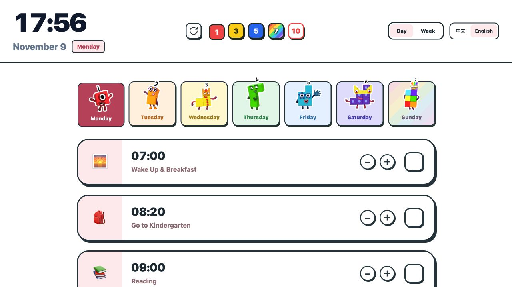

# 4岁宝宝作息时间表

**看看现在该做什么，做完就打个勾。**

一张给 4 岁宝宝和家长一起看的互动式作息表。从起床、吃饭、玩耍到睡觉，把一天拆成一张张容易辨认的卡片。

[**在线打开作息表**](https://siachen03.github.io/toddler-daily-routine/)

## 怎么用

- 切换工作日和周末，查看两套作息。
- 用活动旁的加减按钮调整时间，完成后打勾。
- 展开活动旁的对话标签，可以听家长和孩子的英语示例。
- 点击顶部的刷新按钮，清空当天的勾选并恢复默认时间。

## 部署与链接维护

- 当前仓库：`siachen03/toddler-daily-routine`；正式地址：https://siachen03.github.io/toddler-daily-routine/
- GitHub Pages 使用 `main` 分支的根目录（`/ (root)`）发布，保留 `.nojekyll`，无需构建。
- 本项目是单页静态 HTML，没有前端路由或需要配置的 base path。CSS、交互脚本和图标均内联；Tailwind 使用外部 CDN。
- 新增站内页面或资源时使用相对路径（例如 `./preview.jpg`），避免把域名或以 `/` 开头的根路径写死。
- GitHub 用户名变更后，Pages 的 `github.io` 域名也会变化。请同步更新 README、书签和分享链接；仓库地址的重定向不能替代旧 Pages 网站的跳转。
- 如页面未更新，在仓库 Actions 中确认最新的 “pages build and deployment” 成功，再刷新页面。
